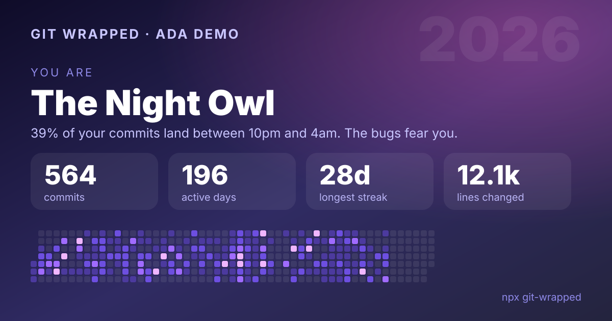

<h1 align="center">🎁 git-wrapped</h1>

<p align="center"><b>Your year in git, Spotify-Wrapped style.</b><br>
One command. Zero dependencies. 100% local.<br>
A terminal report, a scroll-through story page and a shareable card.</p>

<p align="center">
  
</p>

<p align="center"><sub>Demo data from a synthetic repo, not a real developer.</sub></p>

```bash
npx git-wrapped            # this repo, your commits, this year
npx git-wrapped --scan ~/code -f all   # every project on your machine, all outputs
```

That's it. No account, no token, no upload. It only reads `git log`.

## What you get

| Output | Flag | What it is |
| --- | --- | --- |
| **Terminal** | `-f terminal` (default) | Colored report with a contribution map, hourly rhythm, languages, vocabulary |
| **Story page** | `-f html` | Self-contained, animated, scroll-snap "Wrapped" slides in one `.html` file |
| **Share card** | `-f svg` | 1200×630 card, ready for X/LinkedIn/Bluesky or your profile README |
| **Raw data** | `-f json` | Every stat as JSON for your own dashboards |

Use `-f all` for everything. Files land in `./git-wrapped-<year>/`.

## What it measures

- Commits, active days, longest streak, busiest day
- Lines added/removed (lockfiles, minified bundles and `dist/` are ignored)
- Your hourly and weekly rhythm, plus best month
- Top languages by lines changed, most-edited files
- Conventional-commit types (`feat`, `fix`, `refactor`…) and your commit vocabulary
- Hall of fame (biggest commit) and shame (how many commits were just `wip`, `fix`, `.`)
- A **persona**: Night Owl 🦉, Early Bird 🌅, Streak Machine 🔥, Weekend Warrior ⚔️,
  Janitor 🧹, Firefighter 🚒, Rapid Committer ⚡ or Steady Shipper 🚢

## Options

```
git-wrapped [repo ...] [options]

  -y, --year <YYYY>      year to analyze (default: current year)
      --author <email>   only count this author (default: your git user.email)
      --all-authors      count every author
      --name <name>      display name on the card
      --scan <dir>       find every git repo under <dir> (depth 3) and combine them
  -f, --format <list>    terminal,html,svg,json or "all"
  -o, --out <dir>        output directory (default: ./git-wrapped-<year>)
      --no-color         disable colors
```

Commits are de-duplicated by hash, so forks and clones of the same project aren't counted twice.
Timestamps use the author's local time as recorded in the commit.

## Put it on your GitHub profile

```bash
npx git-wrapped --scan ~/code -f svg -o .
```

Commit `wrapped-card.svg` to your profile repo and reference it in the README:

```md

```

## Use it as a library

```js
const { collect, analyze, renderSvg } = require('git-wrapped');

const commits = collect('.', { year: 2026, author: 'me@example.com' });
const stats = analyze(commits, { year: 2026, name: 'Me' });
console.log(stats.persona.name, stats.commits);
```

## Privacy

Everything is computed on your machine from `git log`. The generated HTML has no external requests,
fonts, trackers or CDN links. Commit messages and file names stay inside the files you generate;
review them before you share the HTML (the SVG card only contains aggregate numbers and your name).

## Develop

```bash
git clone <this repo> && cd git-wrapped
npm test          # node:test, no dependencies
node bin/git-wrapped.js --help
```

Requires Node ≥ 18 and git. PRs welcome: new personas, new stats and new card themes are the
most fun contributions.

## License


